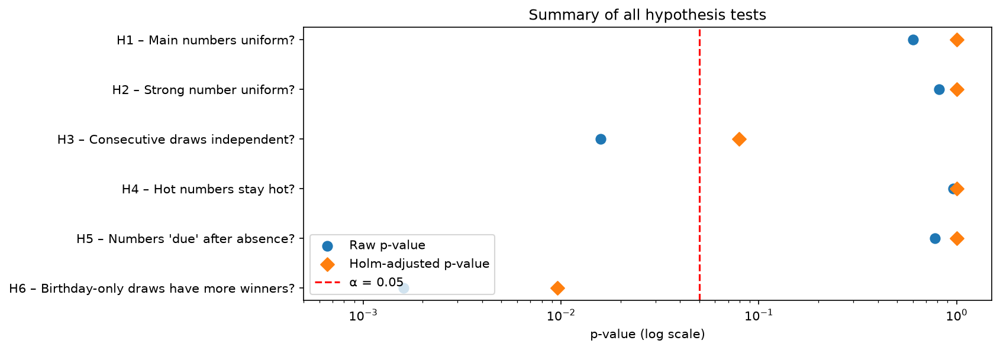
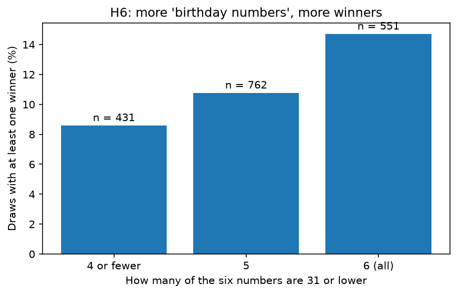
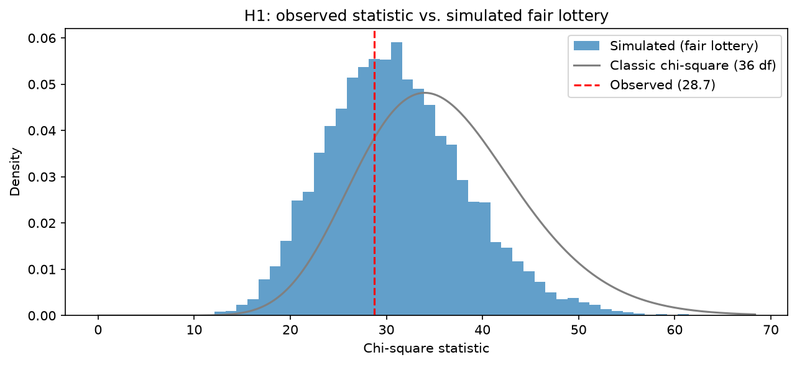

# Is the Israeli Lotto Fair? A Statistical Audit of 1,744 Draws 🎲📊

**TL;DR:** I tested 1,744 draws of the current Israeli Lotto format (6 numbers out of 37 + a strong number out of 7; March 2011 – October 2026) against six hypotheses defined before running any test. The draws behave like a fair lottery: no unequal number frequencies, no "hot" or "due" numbers, no memory between draws. The one robust finding is about the players, not the lottery: draws made only of numbers up to 31 ("birthday numbers") have about 1.6× more main-prize winners.

## 🔍 Key findings

| # | Question | Result | p-value (Holm-adjusted) |
|---|----------|--------|-------------------------|
| H1 | Are the 37 main numbers equally likely? | No evidence against (counts range 245–315, expected 283) | 1.000 |
| H2 | Is the strong number (1–7) uniform? | No evidence against | 1.000 |
| H3 | Are consecutive draws independent? | Borderline before correction (raw p = 0.016), not significant after correction and unstable over time | 0.080 |
| H4 | Do "hot" numbers stay hot year after year? | No (mean rank correlation between years: −0.002) | 1.000 |
| H5 | Is a number "due" after a long absence? | No (gaps match the geometric distribution) | 1.000 |
| H6 | Do birthday-only draws (all numbers ≤ 31) have more winners? | **Yes**: 14.7% of such draws have a winner vs. 10.0% of other draws | **0.0096** |



### The one real effect: players, not the lottery
Many players pick birthdays, so combinations made only of numbers up to 31 are played more often. Every combination is equally likely to be drawn, but when a birthday-only combination comes up, the prize is split among more people. The effect holds for regular tickets, Double tickets and their sum, and grows steadily with the number of birthday numbers in the draw.



## 🧪 Approach
- **Hypotheses and α = 0.05 were written in this README before any test was run** (see the Git history). Two additions came after seeing results and are labeled as exploratory in the notebook: the stability check for H3 and the robustness check for H6.
- **Monte Carlo simulation instead of blind trust in formulas.** Numbers in a draw are drawn without replacement, so the classic chi-square test is only approximate. I simulated 10,000 fair lotteries to get exact reference distributions (for H1 the simulated statistic averages 31.1, not 36 as the textbook distribution assumes).
- **Multiple-testing correction.** Six tests at α = 0.05 give roughly a 26% chance of at least one false positive in a perfectly fair lottery, so p-values are adjusted with the Holm method.



## 🧹 Data
- **Source:** [Official Mifal HaPais Lotto Archive](https://www.pais.co.il/lotto/archive.aspx), downloaded on 2026-10-23. The raw file covers 4,553 draws from 1968 to 2026.
- **Cleaning:** the game rules changed several times. The current format (main numbers 1–37, strong number 1–7) starts on 2011-03-05 (draw 2234), which I found by locating the last draw that breaks the current rules. 1,744 draws remain, and all integrity checks pass (valid ranges, six distinct numbers per draw, no duplicate dates, consecutive draw IDs, no missing values).

## 📁 Repository structure
```text
├── data/
│   ├── raw/
│   │   └── Lotto.csv                       # Original file, never modified
│   └── processed/
│       └── lotto_current_format.csv        # Cleaned data, current format only
├── notebooks/
│   ├── 01_cleaning.ipynb                   # Cleaning and validation
│   ├── 02_eda.ipynb                        # Frequencies and distributions
│   └── 03_hypothesis_tests.ipynb           # H1–H6, Monte Carlo, Holm correction
├── reports/
│   └── figures/                            # Charts used in this README
└── requirements.txt
```

## ▶️ How to reproduce
```bash
python -m venv .venv
.venv\Scripts\activate          # macOS/Linux: source .venv/bin/activate
pip install -r requirements.txt
```
Then run the notebooks in order (01 → 02 → 03).

## ⚠️ Limitations
- Failing to reject a null hypothesis does not prove fairness. With 1,744 draws, only moderate or large deviations are detectable.
- Only about 200 draws have a main-prize winner, so H6 has limited statistical power. Winner counts also depend on ticket sales, which I cannot observe. Because the draw is random, this adds noise but should not bias the comparison.
- The meaning of the winners columns is based on the file's description and was not verified against the official rules.

## 🛠️ Tech stack
Python 3 · pandas · NumPy · SciPy · Matplotlib · Jupyter
